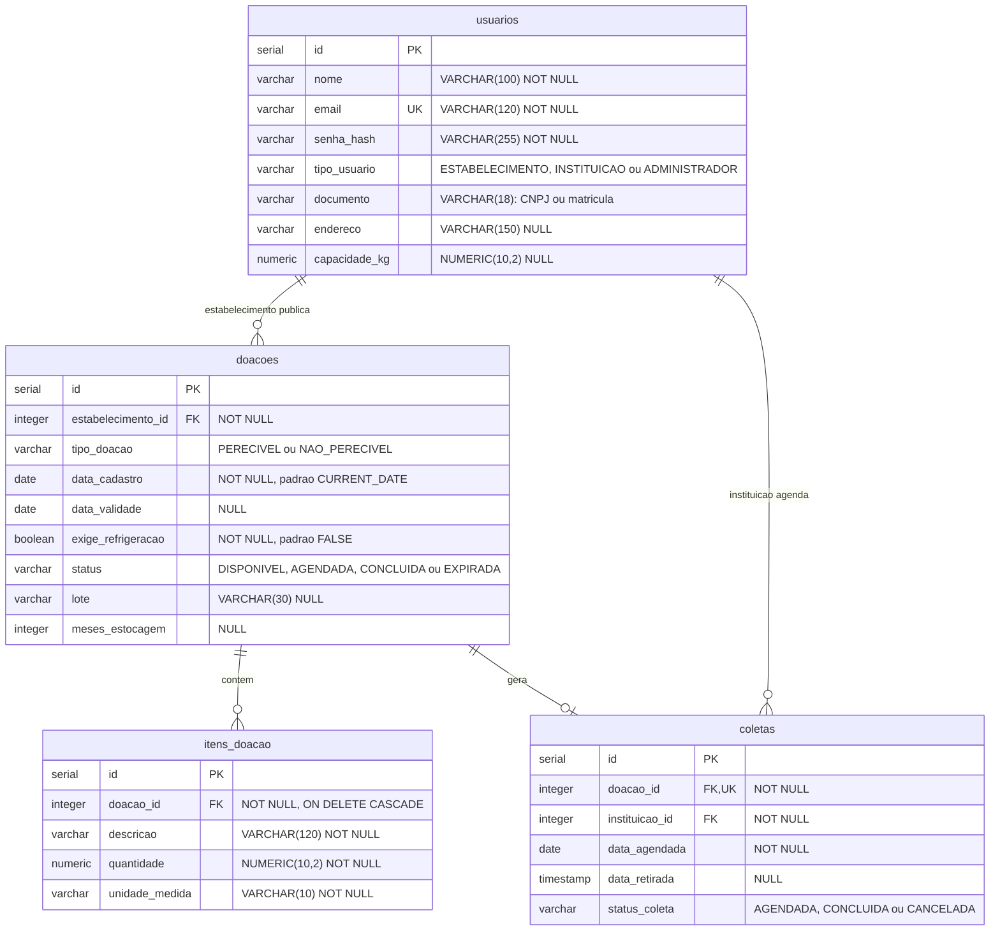
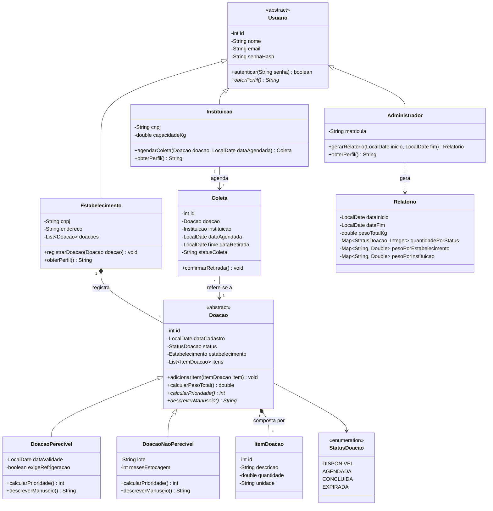

# Diagramas do Sobra Zero

Versão atualizada dos diagramas, alinhada ao código em `src/main/java/com/sobrazero/model/` e ao script `database/schema.sql`. As imagens `diagrama_classes.png` e `diagrama_der.png` desta pasta são as versões entregues no documento da Entrega 1. O que mudou desde então está na seção "Ajustes em relação ao documento da Entrega 1" do [README](../README.md).

## Diagrama de banco de dados (DER)

- **`usuarios`** guarda os três perfis numa tabela só, diferenciados por `tipo_usuario`.
- **`itens_doacao.doacao_id`** tem `ON DELETE CASCADE`: excluir uma doação apaga os itens dela (composição forte).
- **`coletas.doacao_id`** é `UNIQUE`: uma doação nunca é reservada duas vezes (RF04).

## Diagrama de classes (UML)

- **Herança:** `Usuario` e `Doacao` são abstratas. Os métodos em itálico são abstratos e sobrescritos com `@Override` nas subclasses.
- **Polimorfismo:** `calcularPrioridade()` e `descreverManuseio()` têm uma lógica diferente em cada subclasse de `Doacao`. O `PriorizacaoService` ordena uma `List<Doacao>` sem saber o tipo de cada uma.
- **Composição:** os losangos preenchidos indicam que `Doacao` só existe dentro de um `Estabelecimento` e `ItemDoacao` só existe dentro de uma `Doacao`.
